<div align="center">
  

  # EasyBuy

  ### Enterprise Mobile Commerce & Autonomous AI Shopping Architecture

  [](https://reactnative.dev/)
  [](https://expo.dev/)
  [](https://firebase.google.com/)
  [](https://groq.com/)
</div>

<br />

## Executive Summary

EasyBuy is an enterprise-grade, high-concurrency mobile commerce platform engineered on the React Native and Expo framework, backed by a real-time Google Firebase Firestore cloud infrastructure. Designed to bridge hyper-local quick commerce with large-scale multi-category retail, the system features sub-second neural voice search, catalog-grounded conversational artificial intelligence, and regional dynamic inventory routing.

The codebase implements strict separation of concerns, declarative unidirectional state flow, and native UI-thread animation drivers to maintain a deterministic 60fps frame rate across both iOS and Android deployment targets.

---

## Key Architectural Subsystems

### 1. Grounded AI Shopping Concierge & Neural Voice Pipeline
* **Catalog-Grounded Inference:** Implements a retrieval-augmented prompting pattern via Groq (LLaMA 3) that restricts model recommendations to active, verified Firestore catalog records, effectively eliminating generative hallucinations.
* **Low-Latency Neural Speech:** Combines client-side streaming audio buffers with Groq PlayAI synthesis, supported by an automated circuit-breaker fallback to native speech synthesizers during network degradation.
* **Spatial Interactive Voice Interface:** Renders an animated three-dimensional canvas orb providing immediate visual state feedback (listening, thinking, responding) during hands-free transactions.

### 2. Hybrid Quick Commerce & Dynamic Regional Cataloging
* **Ten-Minute Fulfillment Engine:** A segregated, prioritized routing pipeline designed for time-critical household essentials, supporting hyper-local inventory constraints.
* **Geospatial Regional Partitioning:** Leverages device GPS and reverse geocoding to dynamically surface cultural and state-specific inventory pools across thirty-six Indian states and union territories.
* **Interactive Map Location Selector:** Embedded native map interface enabling users to visually adjust delivery pins and resolve precise delivery coordinates in real time.

### 3. Native On-Device Administration Architecture
* **Role-Based Store Control:** Direct mobile administrative access allowing authorized operators to manipulate stock counts, override promotional banners, and audit catalog health without external web portals.
* **Idempotent Batch Processing:** Background maintenance tools and catalog seeders engineered with deterministic write batches to guarantee database consistency without mutating active user sessions.

### 4. Transactional Security & Communication Pipeline
* **Multi-Factor Email Verification:** Live six-digit one-time password (OTP) distribution pipeline executed via asynchronous EmailJS gateways during registration.
* **Encrypted Account Recovery:** Out-of-band password reset pipelines enforcing secure, time-delimited authentication tokens.
* **Automated Order Receipts:** Event-driven transaction notifications dispatched to customer endpoints immediately upon successful order settlement.

---

## Interface Design System

The application utilizes an editorial, luxury-focused design language prioritizing typographic hierarchy, balanced negative space, and dark-mode glassmorphic layers.

<div align="center">
  
  <p><i>Design System Color Spectrum & Contrast Hierarchy</i></p>
</div>

---

## Application Interface Showcase

<div align="center">
  <table style="border: none; background-color: transparent;">
    <tr>
      <td align="center" width="33%">
        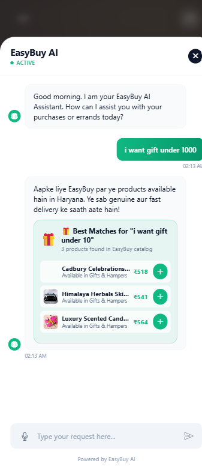
        <br /><br /><b>Splash & Onboarding</b>
      </td>
      <td align="center" width="33%">
        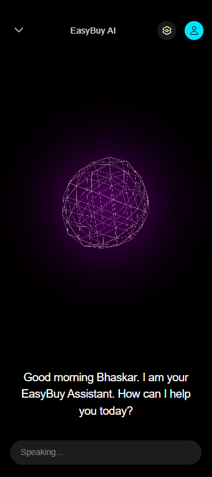
        <br /><br /><b>Curated Home Feed</b>
      </td>
      <td align="center" width="33%">
        
        <br /><br /><b>Neural Voice Interface</b>
      </td>
    </tr>
    <tr>
      <td align="center">
        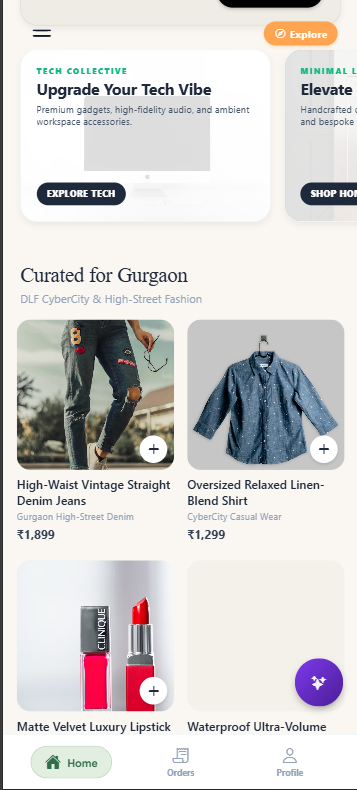
        <br /><br /><b>Conversational Assistant</b>
      </td>
      <td align="center">
        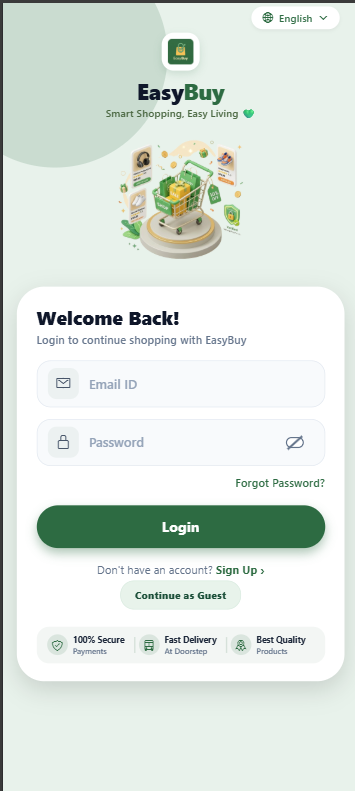
        <br /><br /><b>Account Overview</b>
      </td>
      <td align="center">
        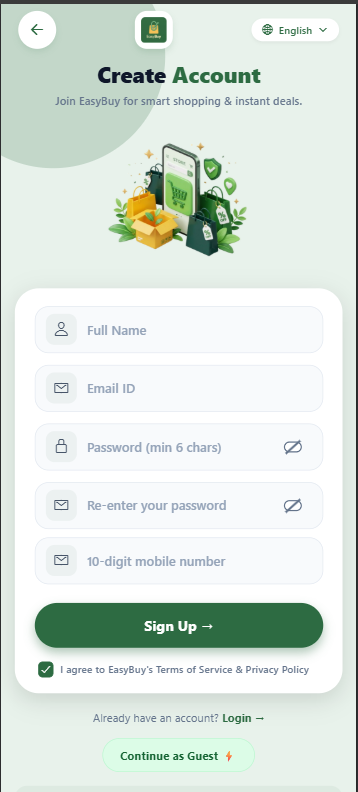
        <br /><br /><b>Checkout Pipeline</b>
      </td>
    </tr>
    <tr>
      <td align="center">
        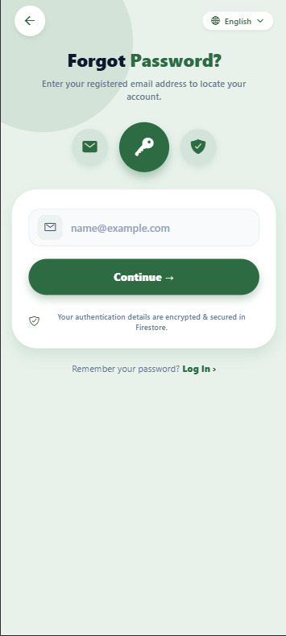
        <br /><br /><b>Fulfillment Tracking</b>
      </td>
      <td align="center">
        
        <br /><br /><b>Administrative Analytics</b>
      </td>
      <td align="center">
        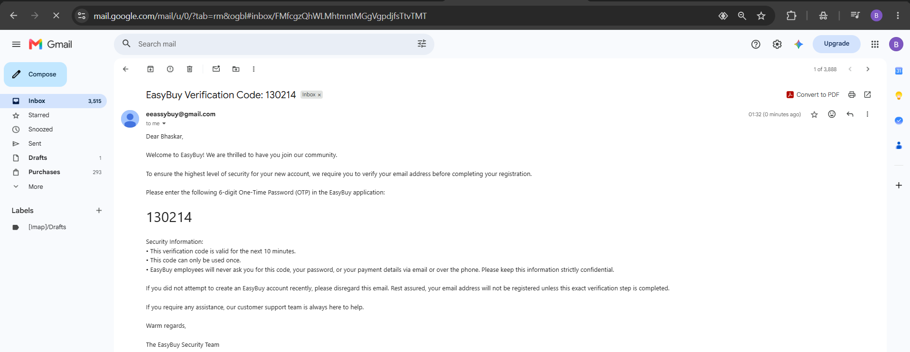
        <br /><br /><b>Inventory Management</b>
      </td>
    </tr>
    <tr>
      <td align="center">
        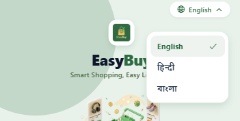
        <br /><br /><b>Verification Protocol</b>
      </td>
      <td align="center">
        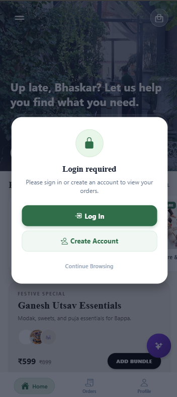
        <br /><br /><b>Geospatial Mapping</b>
      </td>
      <td align="center">
        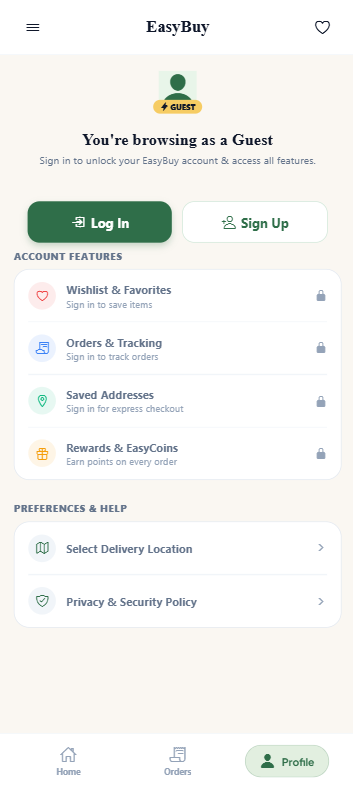
        <br /><br /><b>Model Governance Center</b>
      </td>
    </tr>
    <tr>
      <td align="center">
        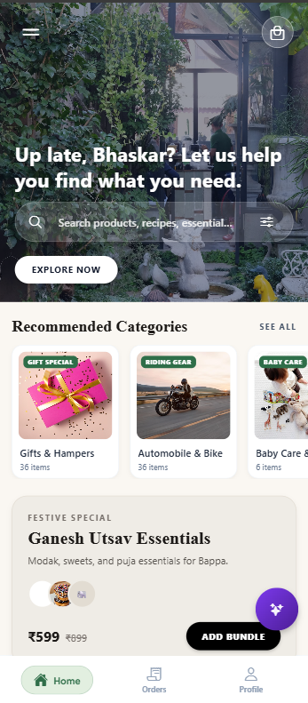
        <br /><br /><b>Catalog Health Auditor</b>
      </td>
      <td align="center">
        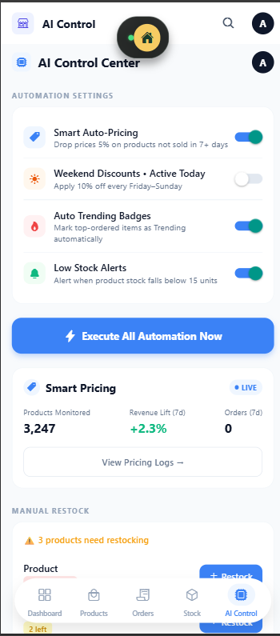
        <br /><br /><b>Product Editor</b>
      </td>
      <td align="center">
        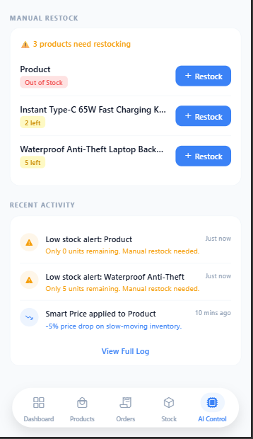
        <br /><br /><b>Authentication Gateway</b>
      </td>
    </tr>
  </table>
</div>

---

## Technical Specifications

| Domain | Implementation |
| :--- | :--- |
| **Framework Ecosystem** | React Native, Expo (SDK 54), Expo Router v6 |
| **State Management** | React Context API, Unidirectional Flux Architecture |
| **Cloud Infrastructure** | Google Cloud Platform, Firebase Firestore, Firebase Authentication |
| **Language Intelligence** | Groq Cloud API, LLaMA 3 Architecture |
| **Motion & Animation** | React Native Reanimated (UI Thread Worklets), Expo Haptics |
| **Telemetry & Quality** | Jest Unit Testing, TypeScript Strict Checking, ESLint Suite |

---

## Development Environment Setup

### System Prerequisites
* Node.js runtime environment (v18.0.0 or higher)
* Package manager: npm or yarn
* Mobile client: Expo Go (iOS / Android) or physical hardware emulator

### Installation Sequence

1. Clone the remote repository:
   ```bash
   git clone https://github.com/nullbhaskar/easybuy.git
   cd easybuy
