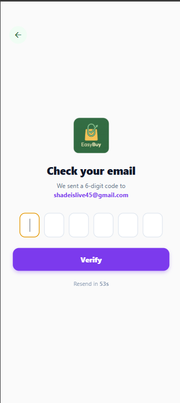
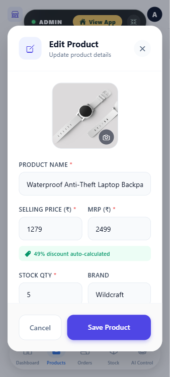

<div align="center">
  

  # EasyBuy

  ### Enterprise Mobile Commerce & Autonomous AI Shopping Architecture

  [](https://reactnative.dev/)
  [](https://expo.dev/)
  [](https://firebase.google.com/)
  [](https://github.com/nullbhaskar/easybuy)
</div>

<br />

## Executive Summary

EasyBuy is an enterprise-grade mobile commerce platform engineered on React Native and Expo SDK 54, backed by Google Firebase Firestore real-time cloud infrastructure. Designed to bridge hyper-local quick commerce with large-scale multi-category retail, the system features sub-second neural voice search, catalog-grounded conversational artificial intelligence, and regional dynamic inventory routing.

The codebase implements strict separation of concerns, declarative unidirectional state flow, and native UI-thread animation drivers to maintain a deterministic 60fps frame rate across iOS and Android deployment targets.

---

## Flagship Interface Showcase

<div align="center">
  <table style="border: none; background-color: transparent;">
    <tr>
      <td align="center" width="25%">
        
        <br /><br /><b>Storefront & Discovery</b>
        <br /><small>Curated Regional Feed & Quick Commerce</small>
      </td>
      <td align="center" width="25%">
        
        <br /><br /><b>AI Shopping Concierge</b>
        <br /><small>Catalog-Grounded Chat & Voice Support</small>
      </td>
      <td align="center" width="25%">
        
        <br /><br /><b>Transactional Email Security</b>
        <br /><small>Email OTP, Password Recovery & Instant Receipts</small>
      </td>
      <td align="center" width="25%">
        
        <br /><br /><b>On-Device Store Admin</b>
        <br /><small>Real-Time Pricing & Inventory Controls</small>
      </td>
    </tr>
  </table>
</div>

---

## Key Architectural Subsystems

### 1. Grounded AI Shopping Concierge & Neural Voice Pipeline
* **Catalog-Grounded Inference:** Implements a retrieval-augmented prompting pattern (RAG) that restricts neural model recommendations strictly to verified Firestore catalog records, preventing hallucination.
* **Low-Latency Neural Speech:** Combines client-side audio streaming buffers with high-throughput neural voice synthesis, backed by automatic fallback to native speech synthesizers during network degradation.
* **Spatial Voice Feedback:** Renders a 3D animated canvas orb providing real-time visual state feedback (listening, thinking, responding) during hands-free transactions.

### 2. Hybrid Quick Commerce & Dynamic Regional Cataloging
* **Ten-Minute Fulfillment Engine:** A segregated, prioritized routing pipeline designed for time-critical household essentials with local stock verification.
* **Geospatial Regional Partitioning:** Leverages device GPS and reverse geocoding to dynamically surface cultural and state-specific inventory pools across thirty-six Indian states and union territories.
* **Interactive Map Location Selector:** Embedded native map interface enabling users to visually adjust delivery pins and resolve precise delivery coordinates in real time.

### 3. Native On-Device Administration Architecture
* **Role-Based Store Control:** Direct mobile administrative access allowing authorized operators to manipulate stock counts, override promotional banners, and audit catalog health without external web portals.
* **Idempotent Batch Processing:** Catalog seeders and maintenance routines engineered with deterministic write batches to guarantee database consistency without mutating active user sessions.

### 4. Transactional Security & Communication Pipeline
* **Multi-Factor Email Verification:** Live six-digit one-time password (OTP) distribution pipeline executed via asynchronous EmailJS gateways during registration.
* **Encrypted Account Recovery:** Out-of-band password reset pipelines enforcing secure, time-delimited authentication tokens.
* **Automated Order Receipts:** Event-driven transaction notifications dispatched to customer endpoints immediately upon successful order settlement.

---

## Design System

<div align="center">
  
</div>

<br />

| Color Token | Hex Value | Semantic Usage |
| :--- | :--- | :--- |
| **Deep Midnight** | `#2F6B3F` / Dark Base | Primary structural surfaces, headers, and navigation anchors |
| **Mint Accent** | `#7FB77E` | Interactive call-to-action controls, badges, and active state highlights |
| **Subtle Sage** | `#B7D7B8` | Input borders, card dividers, and secondary component surfaces |
| **Parchment White** | `#F7FBF7` | Primary viewport background canvas and high-contrast text containers |

---

## Technical Specifications

| Domain | Implementation |
| :--- | :--- |
| **Framework Ecosystem** | React Native, Expo (SDK 54), Expo Router v6 |
| **State Management** | React Context API, Unidirectional Flux Architecture |
| **Cloud Infrastructure** | Google Cloud Platform, Firebase Firestore, Firebase Authentication |
| **Language Intelligence** | Autonomous LLM Pipeline, Neural Speech Synthesis, RAG Catalog Grounding |
| **Motion & Animation** | React Native Reanimated (UI Thread Worklets), Expo Haptics |
| **Telemetry & Quality** | Jest Unit Testing, TypeScript Strict Checking, ESLint Suite |

---

## Development Environment Setup

### System Prerequisites
* Node.js runtime environment (v18.0.0 or higher)
* Package manager: npm or yarn
* Mobile client: Expo Go (iOS / Android) or physical hardware emulator

### Installation Sequence

1. Clone the repository:
   ```bash
   git clone https://github.com/nullbhaskar/easybuy.git
   cd easybuy
   ```

2. Install project dependencies:
   ```bash
   npm install
   ```

3. Configure environment variables in a `.env` file at the project root:
   ```env
   EXPO_PUBLIC_FIREBASE_API_KEY=your_firebase_api_key
   EXPO_PUBLIC_FIREBASE_AUTH_DOMAIN=your_project.firebaseapp.com
   EXPO_PUBLIC_FIREBASE_PROJECT_ID=your_project_id
   EXPO_PUBLIC_FIREBASE_STORAGE_BUCKET=your_project.appspot.com
   EXPO_PUBLIC_FIREBASE_MESSAGING_SENDER_ID=your_messaging_sender_id
   EXPO_PUBLIC_FIREBASE_APP_ID=your_app_id
   EXPO_PUBLIC_AI_API_KEY=your_llm_api_key
   ```

4. Launch the local development server:
   ```bash
   npx expo start
   ```

---

## License

This project is licensed under the MIT License. See the [LICENSE](LICENSE) file for full terms.
